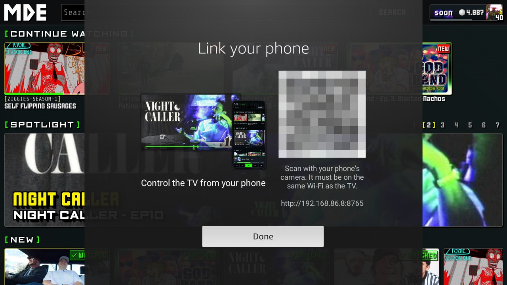
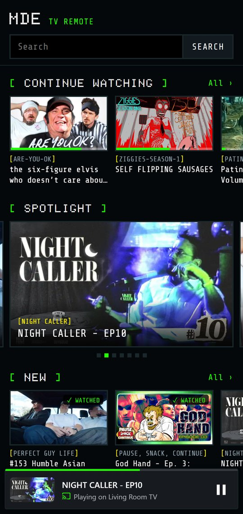
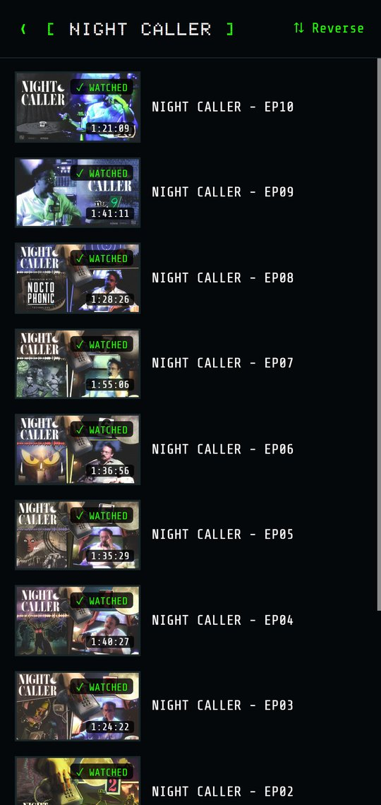
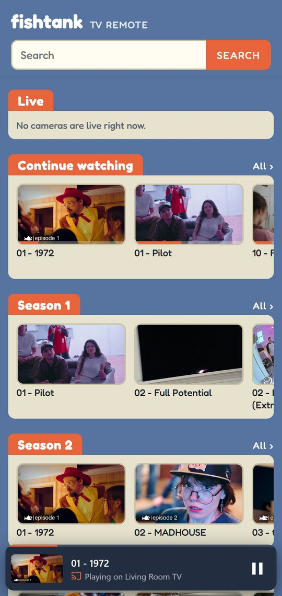
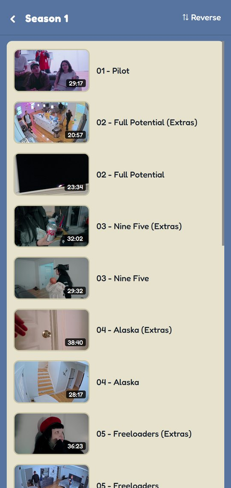

# fttv

Fire TV apps for **fishtank.live** and **mde.tv**.

built by [soon](https://x.com/emty_h3v) @ [fishtank.news](https://fishtank.news)

Unofficial. Not affiliated with, endorsed by, or supported by either site.

| | | |
|---|---|---|
|  | **Fishtank TV** | [Download](https://github.com/michaety/fttv/releases/latest/download/fishtank-tv.apk) |
|  | **MDE TV** | [Download](https://github.com/michaety/fttv/releases/latest/download/mde-tv.apk) |

<table>
<tr>
<td></td>
<td></td>
</tr>
</table>

## Features

- **TV layout:** clutter removed and easy navigation for your TV.
- **Remote control:** browse the site with the arrows and Select.
- **Remote control from your phone:** browse, search and play on the TV from
  your phone. See [Phone remote](#phone-remote).
- **Search:** MDE's search box is in the header.
- **Scrubbing:** left and right show a preview of where you'll jump to.
- **63% less CPU:** compared with v1.0, measured on MDE's homepage.
- **Subtitles:** on MDE, from the Menu (☰) button.
- **Autoplay:** the next episode starts when one finishes. Back cancels.
- **Continue watching:** pick up where you left off, or start the next episode.
- **Tidier Fishtank episodes:** seasons run oldest to newest, and the BTS
  videos are together in the BTS tab.
- **Auto-updates:** the app offers new versions when it opens. On Fire TV's
  confirm screen, move right to **INSTALL** (it starts on Cancel).

## Phone remote

On the TV, press the Menu (☰) button and choose **Link your phone**, then scan
the QR code with your phone's camera. Your phone needs to be on the same Wi-Fi
as the TV.

Your phone gets the app's rows and search: Continue watching, MDE's
Spotlight, playlists and series, or Fishtank's seasons and live cameras. Tap
something and it plays on the TV, then pause, skip and scrub from the bar at
the bottom.

<table>
<tr>
<td></td>
<td></td>
<td></td>
<td></td>
</tr>
</table>

To skip the QR code next time, add the page to your home screen (Chrome:
⋮ → Add to Home screen → Create shortcut; Safari: Share → Add to Home
Screen). The link keeps working as long as the TV app is open and the TV
keeps the same address on your network.

## Limitations

- **No Google sign-in:** sign in with your email and password instead.
- **Speed:** it runs the full desktop site, so pages load slowly on a Firestick.
- **Subtitles:** MDE only; Fishtank's player doesn't support them.
- **Continue watching:** it only knows what you've watched on that TV.
  Neither site saves your place to your account.
- **Navigation:** it follows the page layout, so it can occasionally pick an
  unexpected item.

## Requirements

- A Fire TV or Android TV device. These were tested on a Fire TV Stick 4K
  (2nd gen).
- An account on the site, **with a password**. Google sign-in doesn't work
  in the app, so if you only use Google, set a password with "forgot
  password" on the site first.

## Installing

First, enable Developer Options: Settings → My Fire TV → About, then click
your device name seven times.

**1. Allow app installs**

Settings → My Fire TV → Developer Options → Install Unknown Apps → enable it
for whichever app you'll install from (Downloader, or your file manager).

**2. Get the APK**

Download the latest release from the
[Releases](../../releases) page. Each release has two files:

- `fishtank-tv.apk`
- `mde-tv.apk`

**3. Install it**

Option 1: **[Downloader](https://www.amazon.com.au/AFTVnews-com-Downloader/dp/B01N0BP507?dplnkId=e9566ed7-f213-4ad2-89a4-d1566c14b1ee)**
app from the Amazon Appstore — enter the release URL (or go to this url), it downloads and prompts
to install.

Option 2: **[Apps2Fire](https://play.google.com/store/apps/details?id=mobi.koni.appstofiretv)**
pushes an APK from your Android phone over wifi. Install Apps2Fire, then the apks of your choosing and push the installs to your Firestick.

**4. Launch and sign in**

The app appears in your apps row. Open it, sign in with email and password,
and you're done.

## Notes

These are just a TV-friendly wrapper around the websites, so expect some
rough edges, and a site redesign may break things until the app is updated. They don't
collect anything or bypass anything.
