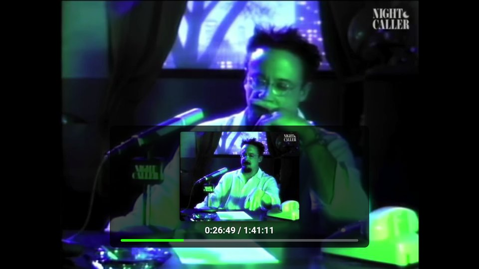
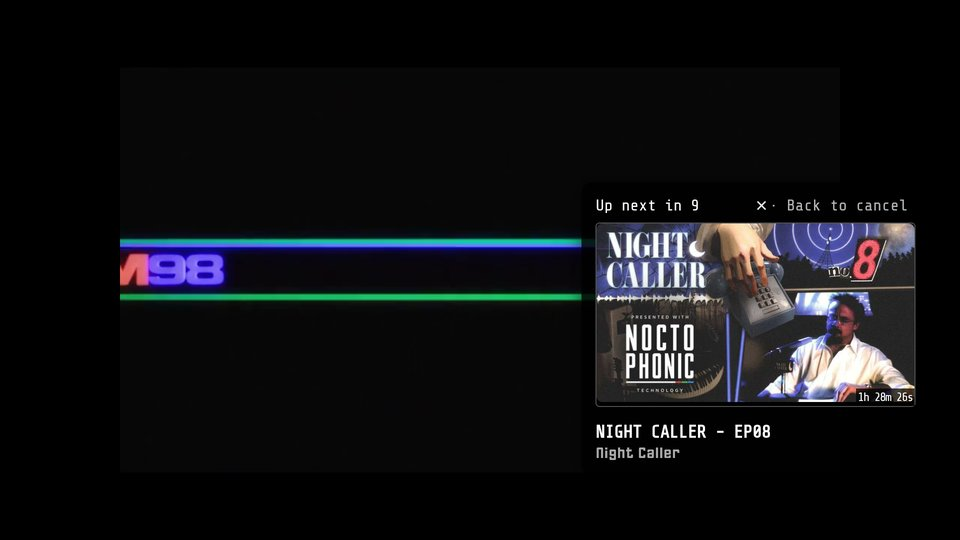

# fttv

Fire TV apps for **fishtank.live** and **mde.tv**.

built by [soon](https://x.com/emty_h3v) @ [fishtank.news](https://fishtank.news)

Unofficial. Not affiliated with, endorsed by, or supported by either site.

| | | |
|---|---|---|
|  | **Fishtank TV** — fishtank.live | [Download](https://github.com/michaety/fttv/releases/latest/download/fishtank-tv.apk) |
|  | **MDE TV** — mde.tv | [Download](https://github.com/michaety/fttv/releases/latest/download/mde-tv.apk) |

Install one or both. See [Installing](#installing) for how to sideload them.

<table>
<tr>
<td></td>
<td></td>
</tr>
</table>

---

## Features

**Browsing**
- **Made for the remote.** The arrows move between items, and the selected
  one zooms in. Select opens it.
- **Clutter removed.** Chat panels, nav bars, audio players, ad banners and
  purchase prompts are hidden.
- **Search on MDE.** Move up to the search box in the header and press
  Select. Type your search, then press **Next** on the keyboard.
- **Fishtank Episodes page tidied up.** Two full rows fit on screen, and every
  section's **View All** can be reached. All 8 cams fit on the homepage.

**Watching**
- **Scrubbing with previews.** Left and right move a marker along the time
  bar and show a thumbnail of that point, without interrupting the video.
- **Resume where you left off**, and **Up next**: when an episode finishes, a
  card shows the next one's thumbnail and title with a countdown.
- **Subtitles** on MDE, from the Menu (☰) button.
- **Notifications show over the video.** Achievement, mission and reward
  pop-ups appear along the bottom of the screen.

**Under the hood**
- **Updates itself.** The app checks for new versions when it opens and
  offers to install them.
- **Lighter on the Firestick.** MDE's homepage uses about **63% less CPU**
  than v1.0 (143% → 52% on a Fire TV Stick 4K 2nd gen, averaged over three
  runs). Page loads and episode start times are set by the sites themselves,
  so they're about the same.
- **The TV can sleep.** The screen stays on only while something is playing.
- **Video works on current Fire TV software.** It includes a workaround for an
  Amazon bug that plays video as a black screen in apps like this one.

<table>
<tr>
<td></td>
<td></td>
</tr>
<tr>
<td align="center">Scrubbing with a preview</td>
<td align="center">Up next</td>
</tr>
</table>

### Limitations

These are the websites in a wrapper, not native TV apps:

- **The Firestick runs a full desktop web app.** It's usable, not fast.
- **Navigation is approximate.** It follows the page layout, so it can
  occasionally pick an unexpected item.
- **Site changes can break things.** If either site is redesigned, some
  hiding or navigation may stop working until the app is updated.
- **No Google sign-in.** See [Requirements](#requirements).
- **No casting to the app.** The cast button on the websites only finds
  Chromecast devices.

---

## Remote controls

| Button | Browsing | While watching |
|---|---|---|
| **Arrows** | Move between items | **Left/Right:** scrub (hold to go faster) · **Up/Down:** show the time bar |
| **Select** | Open the selected item | Play/pause, or jump to the scrub point |
| **Back** | Back to the homepage · press twice there to exit | Cancel a scrub or Up next · otherwise back to the homepage |
| **Play/Pause** | | Play/pause |
| **Fast-forward / Rewind** | | Scrub forward / back |
| **Menu (☰)** | App menu: check for updates, reload, reset the cursor | Also: subtitles on/off (MDE) |

**Scrubbing:** each press moves 10 seconds, and holding speeds up to 30 and
then 60 second steps. The video jumps when you press Select, or by itself a
moment after you stop pressing.

**Up next:** on MDE, the site picks the next episode. On Fishtank, it's the
next episode in the row you opened the current one from.

---

## Requirements

- **A Fire TV Stick or other Fire TV device.** The apps were developed and
  tested on a Fire TV Stick 4K (2nd gen); older devices may be too slow.
  Other Android TV devices should work, but are untested.
- **An account on the site.** The apps don't create accounts or bypass
  anything.
- **A password on that account.** Google sign-in doesn't work inside the apps.
  If your account is Google-only, use "forgot password" on the site to set
  one, then sign in on the TV with email and password. You can still use
  Google sign-in everywhere else.

---

## Installing

**1. Enable Developer Options.** Settings → My Fire TV → About, then select
your device name seven times.

**2. Allow app installs.** Settings → My Fire TV → Developer Options →
Install Unknown Apps, and turn it on for the app you'll install with.

**3. Install the APK.** Use one of these:

- **[Downloader](https://www.amazon.com.au/AFTVnews-com-Downloader/dp/B01N0BP507)**
  (Amazon Appstore). Enter one of these addresses and follow the prompts:
  - `https://github.com/michaety/fttv/releases/latest/download/fishtank-tv.apk`
  - `https://github.com/michaety/fttv/releases/latest/download/mde-tv.apk`
- **[Apps2Fire](https://play.google.com/store/apps/details?id=mobi.koni.appstofiretv)**
  on an Android phone. Download the APK from the
  [Releases](../../releases/latest) page to your phone, then push it to the
  Fire TV over Wi-Fi.

**4. Open the app and sign in** with your email and password. It appears in
your apps row.

---

## Updating

From v1.2.0, the apps check for updates when they open, download them in
the background, and ask before installing. You can also check any time from
the **Menu (☰)** button. When Fire TV asks you to confirm, move right to
**INSTALL**, because it starts on Cancel. The first time, Fire TV may also ask
you to let the app install apps. You stay signed in.

On an older version, update once by hand: install the latest APK the same
way as the first time. It installs over the old one.

I made these so I could watch this content on my TV. Beyond fixing updates
that break the apps, I'm not maintaining them.

---

## Notes

These apps show websites you already have accounts for. They don't get around
payment, DRM or access controls, and they don't collect anything: there's no
analytics or telemetry. The only connections besides the sites themselves are
the update check and downloads, which go to this GitHub repository.
