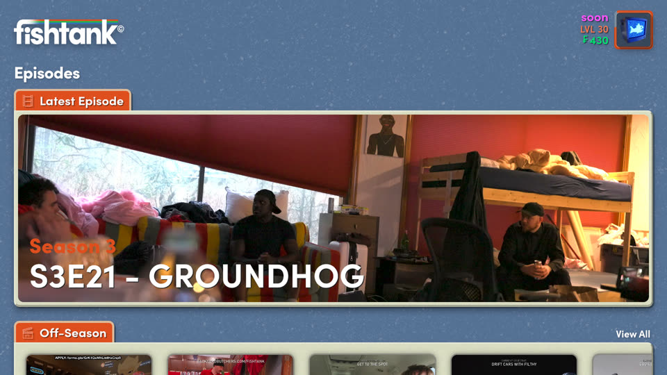
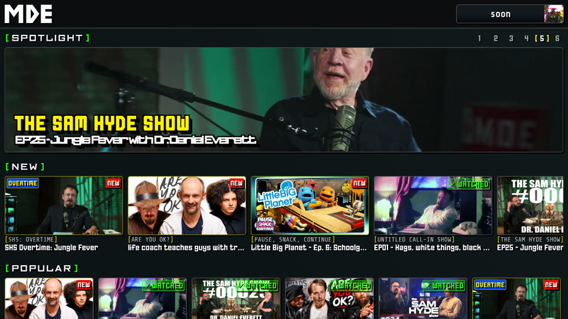

# fttv

Fire TV apps for **fishtank.live** and **mde.tv**.

built by [soon](https://x.com/emty_h3v) @ [fishtank.news](https://fishtank.news)

Unofficial. Not affiliated with, endorsed by, or supported by either site.

---

| | | |
|---|---|---|
|  | **Fishtank TV** — fishtank.live | [Download](https://github.com/michaety/fttv/releases/latest/download/fishtank-tv.apk) |
|  | **MDE TV** — mde.tv | [Download](https://github.com/michaety/fttv/releases/latest/download/mde-tv.apk) |

Install one or both. See [Installing](#installing) below for
how to sideload the APK on a Fire TV device.

<table>
<tr>
<td></td>
<td></td>
</tr>
</table>

### What they do

- **Remote navigation.** Arrow keys move between items on the page (the
  selected one zooms in), Select activates it.
- **TV-appropriate layout.** The desktop site, not the phone one, so it's
  built for a wide screen.
- **Clutter removed.** Chat panels, nav bars, audio players, ad banners and
  purchase prompts are hidden.
- **Search on MDE.** The search box sits in the header: move up to it, press
  Select, type, then press **Next** on the keyboard to search.
- **Lighter on the Firestick.** About **63% less CPU** while browsing MDE's
  homepage than v1.0 (143% → 52% on a Fire TV Stick 4K 2nd gen, average of
  three runs), mostly by not playing preview videos and animations nobody
  asked for. Page loads and episode start times are about the same as
  before: those are set by the sites themselves.

Navigating with the remote:

<table>
<tr>
<td></td>
<td></td>
</tr>
</table>

### What they don't do

These are websites in a wrapper, not native TV apps. **Expect some rough edges**:

- Navigation is approximate. Can be buggy.
- The Firestick is running a full desktop web app. **It is not fast.**
- Anything the site changes on their end may break something here.
- Sign in with Google. See requirements below.

---

## Requirements

- A Fire TV Stick or Fire TV device. **Developed and tested on a Fire TV Stick
  4K (2nd gen)** — anything older than this may be unusable. It's a standard
  Android TV app under the hood, so it should work fine on any Android TV
  device too, just untested there.
- An account on whichever site you're installing for — these apps don't
  create accounts or bypass anything
- **A password on that account.** Google sign-in does not work. If your account is Google-only, use "forgot
  password" on the site to set one first, then sign in with email and
  password on the TV. This won't disable you from logging in with Google elsewhere in future.

---

## Installing

First, enable Developer Options: Settings → My Fire TV → About, then click
your device name seven times.

**1. Allow app installs**

Settings → My Fire TV → Developer Options → Install Unknown Apps → enable it
for whichever app you'll install from (Downloader, or your file manager).

**2. Get the APK**

Download the latest release from the
[Releases](../../releases) page. Each release has two files:

- `fishtank-tv.apk`
- `mde-tv.apk`

**3. Install it**

Option 1: **[Downloader](https://www.amazon.com.au/AFTVnews-com-Downloader/dp/B01N0BP507?dplnkId=e9566ed7-f213-4ad2-89a4-d1566c14b1ee)**
app from the Amazon Appstore — enter the release URL (or go to this url), it downloads and prompts
to install.

Option 2: **[Apps2Fire](https://play.google.com/store/apps/details?id=mobi.koni.appstofiretv)**
pushes an APK from your Android phone over wifi. Install Apps2Fire, then the apks of your choosing and push the installs to your Firestick.

**4. Launch and sign in**

The app appears in your apps row. Open it, sign in with email and password,
and you're done.

---

## Remote controls

| Button | Does |
|---|---|
| **Arrows** | Navigation |
| **Select** | Selects |
| **Back** | Returns to the homepage; press twice on the homepage to exit |
| **Play/Pause** | Play or pause the video |
| **Fast-forward** / **Rewind** | Scrub forward / back (see below) |
| **Menu (☰)** | App menu: check for updates, reload the page, reset the cursor |

While a video is playing:

| Button | Does |
|---|---|
| **Select** | Play or pause (or jump to the scrub point, while scrubbing) |
| **Left** / **Right** | Scrub back / forward, with a preview thumbnail. Each press moves 10s; hold to speed up (30s, then 60s steps) |
| **Back** | While scrubbing: cancel and stay where you were |
| **Up** / **Down** | Show the time bar |

Scrubbing moves a marker without touching the video. It jumps when you
press **Select**, or by itself a moment after you stop pressing.

---

## Updating and maintenance

From v1.2.0 the apps check for updates when they start, download any new
version in the background, and offer to install it. You can also check any
time from the remote's **Menu (☰)** button (from v1.3.0). When Fire TV asks to confirm, move right to **INSTALL** (it starts on
Cancel). The first time, it may also ask you to allow the app to install
apps. You stay signed in.

On an older version, update once by hand: download the new APK from the
[latest release](../../releases/latest) and install it the same way as the
first time (Downloader or Apps2Fire). It installs over the old version.

I created this selfishly so I could watch this content on my TV. Anything beyond an update that breaks the app I will not be maintaining.

---

## Notes

These apps display websites you already have accounts for. They don't
circumvent payment, DRM, or access controls, and they don't collect anything —
there's no analytics, no telemetry, and no server involved beyond the sites
themselves.
