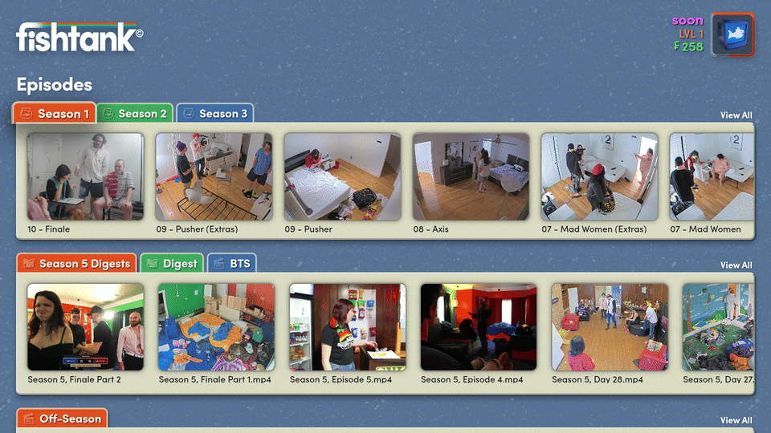
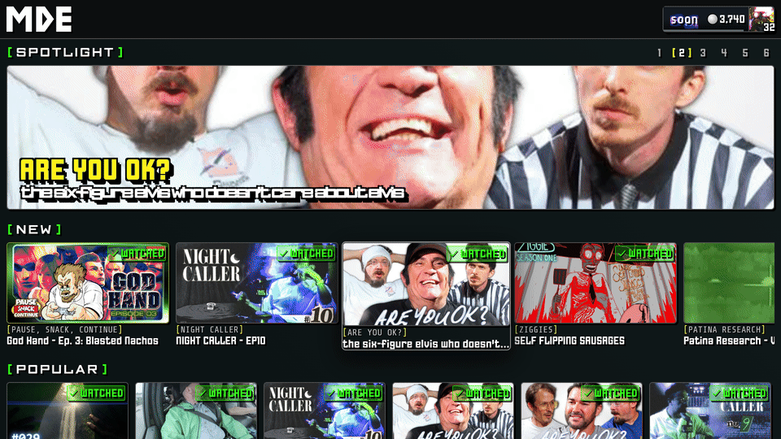
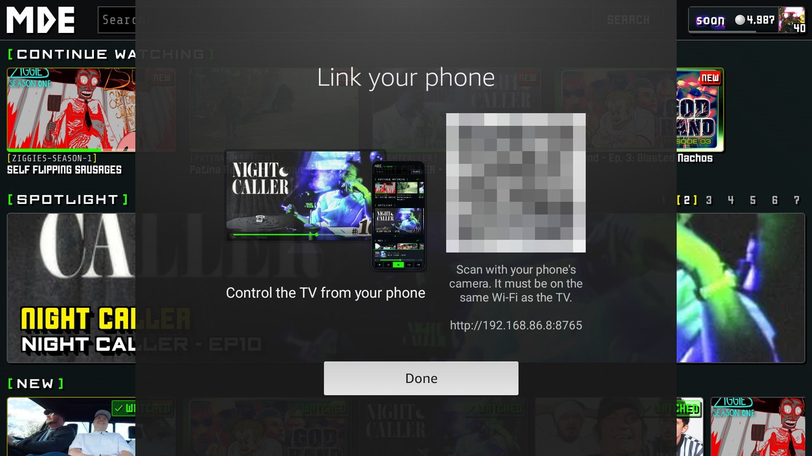
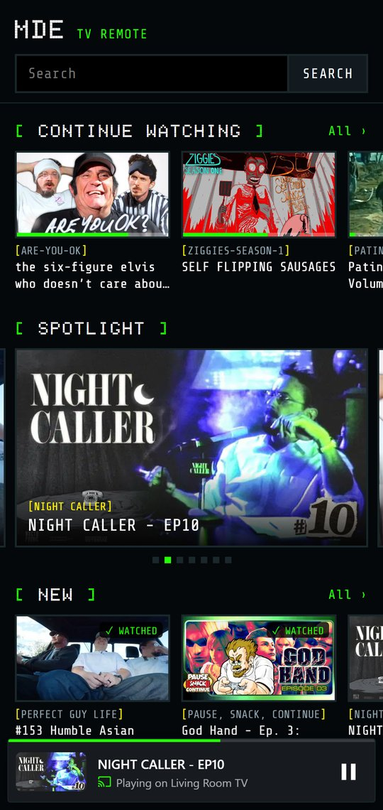
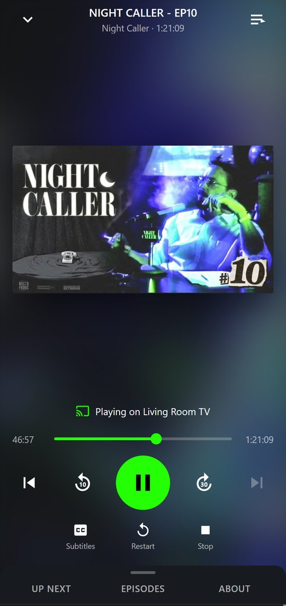
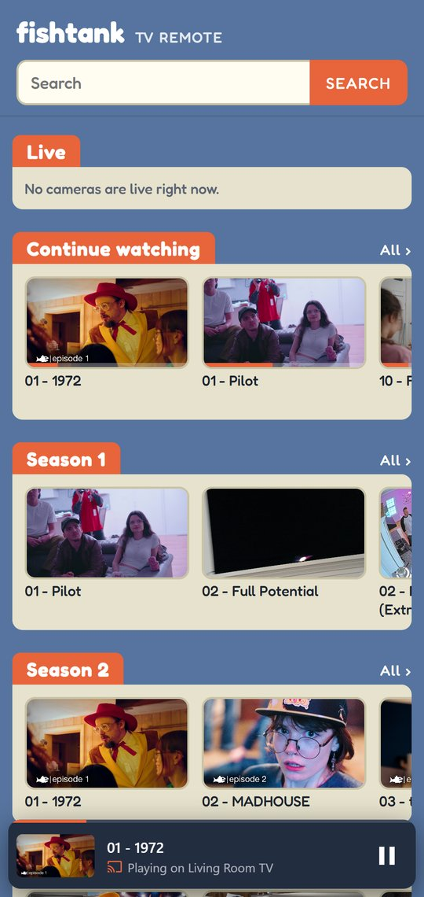
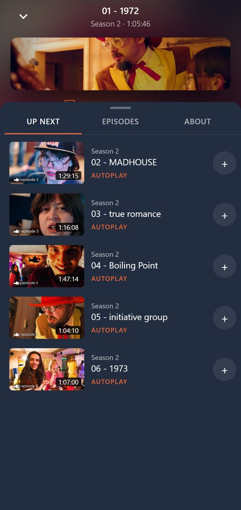

# fttv

Fire TV apps for **fishtank.live** and **mde.tv**.

built by [soon](https://x.com/emty_h3v) @ [fishtank.news](https://fishtank.news)

Unofficial. Not affiliated with, endorsed by, or supported by either site.

| | | |
|---|---|---|
|  | **Fishtank TV** | [Download](https://github.com/michaety/fttv/releases/latest/download/fishtank-tv.apk) |
|  | **MDE TV** | [Download](https://github.com/michaety/fttv/releases/latest/download/mde-tv.apk) |

<table>
<tr>
<td></td>
<td></td>
</tr>
</table>

## Features

- **TV layout:** clutter removed for easy navigation of your TV.
- **Sign in with your phone:** scan the code and type your email and password on your phone instead of with the remote.
- **[Link your phone](#link-your-phone):** browse, search and play on the TV from your phone, plus
  themes, comments, and more.
- **Live TV (MDE):** Tune in to the TV guide.
- **Search:** MDE's search box is in the header.
- **63% less CPU:** compared with v1.0, measured on MDE's homepage.
- **Subtitles:** on MDE, from the Menu (☰) button.
- **Autoplay:** the next episode starts when one finishes.
- **Continue watching and account playback sync:** pick up where you left off, or start the next episode on any device.
- **Hold Select on a card:** a long-press menu to play, queue, shuffle or remove from
  Continue watching
- **Auto-updates:** the app offers new versions when it opens.

## Link your phone

Press Menu (☰) on the TV, choose **Link your phone** and scan the QR code. Pick something on your phone and it plays on the TV, with
full controls and a queue. You can also change the app's theme from your phone, read and post
comments, and like episodes. Add the page to your home screen to skip the QR
code next time.

<table>
<tr>
<td></td>
<td></td>
<td></td>
<td></td>
</tr>
</table>

## Limitations

- **No Google sign-in:** sign in with your email and password instead.
- **Speed:** it runs the full desktop site, so pages can load slowly.
- **Subtitles:** MDE only; Fishtank's player doesn't support them.
- **Navigation:** it follows the page layout, so it can occasionally pick an
  unexpected item.

## Requirements

- A Fire TV or Android TV device. These were tested on a Fire TV Stick 4K
  (2nd gen).
- An account on the site, **with a password**. Google sign-in doesn't work
  in the app, so if you only use Google, set a password with "forgot
  password" on the site first. This won't prevent you from signing in with Google elsewhere.

## Installing

First, enable Developer Options: Settings → My Fire TV → About, then click
your device name seven times.

**1. Allow app installs**

Settings → My Fire TV → Developer Options → Install Unknown Apps → enable it
for whichever app you'll install from (Downloader, or your file manager).

**2. Get the APK**

Download the latest release from the
[Releases](../../releases) page. Each release has two files:

- `fishtank-tv.apk`
- `mde-tv.apk`

**3. Install it**

Option 1: **[Downloader](https://www.amazon.com.au/AFTVnews-com-Downloader/dp/B01N0BP507?dplnkId=e9566ed7-f213-4ad2-89a4-d1566c14b1ee)**
app from the Amazon Appstore — enter the release URL (or go to this url), it downloads and prompts
to install.

Option 2: **[Apps2Fire](https://play.google.com/store/apps/details?id=mobi.koni.appstofiretv)**
pushes an APK from your Android phone over wifi. Install Apps2Fire, then the apks of your choosing and push the installs to your Firestick.

## Notes

These are just a TV-friendly wrapper around the websites, so expect some
rough edges, and a site redesign may break things until the app is updated. They don't
collect anything or bypass anything.
